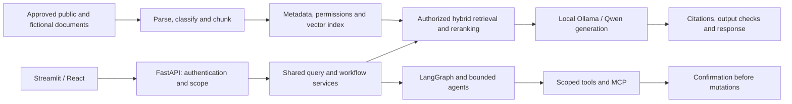

# EnterpriseMind AI architecture

## Application boundary

EnterpriseMind AI serves knowledge lookup and approved workflows across HR,
IT/security, finance, product, support and technical domains. A modular Python
application owns domain models/services; local inference and interchangeable
framework/storage adapters surround those contracts. React is a separate client;
Streamlit supplies an earlier demonstration interface.

This diagram describes future behavior. EM-001 implements only the root package.
Framework-independent RAG first establishes a measurable baseline; LangChain and
LangGraph later reuse it. Each tool invocation rechecks authorization; model text
does not grant permission. MLflow/OTel/Prometheus/Grafana observe redacted events.

## Future module map (create at the relevant stage)

Paths below preserve the proposed professional structure. They do not exist as
placeholder directories in EM-001. Python paths are under `src/enterprise_mind/`.

| Path | Responsibility | First needed |
| --- | --- | --- |
| `core/`, `domain/`, `services/` | Settings, typed records, errors and shared use cases | Stages 1-3, as real behavior begins |
| `ingestion/{connectors,parsers,cleaning,chunking,pipelines}/` | Source approval, parsing, normalization and incremental ingestion | Stages 1 and 3 |
| `llm/{providers,embeddings,generation}/` | Ollama/Hugging Face adapters, embeddings, structured/streamed generation | Stages 2-3 |
| `rag/{indexing,retrieval,reranking,context,citations,pipelines}/` | Baseline through hybrid RAG, citations, budgets and abstention | Stages 3 and 5 |
| `integrations/langchain/` | Framework adapters around shared logic | Stage 4 |
| `integrations/langgraph/{graphs,nodes,checkpoints}/` | Stateful bounded workflows and resumable execution | Stage 6 |
| `agents/{roles,tools,orchestration,policies}/` | Research, verification, synthesis and workflow permissions | Stages 6-7 |
| `mcp/{clients,servers,permissions}/` | MCP transport, typed contracts and scoped capabilities | Stage 7 |
| `finetuning/{datasets,training,adapters,export}/` | LoRA/QLoRA recipes, model lineage and adapter export | Stage 8 |
| `guardrails/{input,output,authorization,policies}/` | Validation, PII protection, injection defenses and authorization | Baseline throughout; Stage 9 expansion |
| `evaluation/{datasets,metrics,runners,reports}/` | Deterministic/local-judge RAG and agent quality evaluation | Baseline from Stage 3; Stage 10 expansion |
| `storage/{repositories,relational,vector,blobs}/` | Storage contracts and concrete backends | Stage 3 onward; Stage 11 persistence expansion |
| `api/{routes,schemas,dependencies,middleware}/`, `workers/` | FastAPI, sessions, streaming and durable background jobs | Stage 11 |
| `observability/` | Redacted logs, metrics, tracing and lineage | Baseline throughout; Stage 13 expansion |

Other planned repository paths:

- `configs/{ingestion,retrieval,agents,finetuning,guardrails,evaluation}/`:
  reviewed non-secret configuration; secret values come from runtime settings.
- `prompts/{rag,agents,evaluation}/`: versioned prompt templates from Stage 2.
- `data/{raw,processed,private,uploads,indexes,training}/`: ignored runtime data;
  only separately reviewed provenance/attribution metadata may be versioned.
- `models/{base,adapters}/`, `artifacts/{evaluations,experiments,logs,exports}/`:
  ignored model and generated outputs.
- `tests/{fixtures,unit,integration,contract,security,agents,e2e}/`, `benchmarks/`:
  add when meaningful tests exist; fixtures contain no real private records.
- `notebooks/`: optional exploration; output-bearing notebooks remain ignored
  unless reviewed and explicitly approved. Reusable code belongs in `src/`.
- `frontend/src/{components,features/{chat,documents,agent_runs},api,hooks,types}/`:
  React client in Stage 11; the Streamlit demo lives with its presentation layer.
- `migrations/versions/`: Alembic database schema evolution in Stage 11.
- `scripts/{development,ingestion,evaluation,operations}/`: thin reusable wrappers
  created only when there is an actual operation to support.
- `deployment/{containers,compose,reverse_proxy,monitoring,cloud}/` and
  `.github/workflows/`: containerization, CI and AWS concepts in Stage 12.
- `docs/architecture/decisions/`, `docs/development/`, `docs/security/`,
  `docs/evaluation/`, `docs/operations/runbooks/`, `docs/portfolio/`: decisions,
  developer guides, threat model, evaluations, runbooks and case study as needed.

## Contracts and production boundaries

- Documents/chunks carry source revision, checksum, domain, tenant, visibility
  and citation anchors. Content hashing supports deduplication and reindexing.
- Ingestion workers have scoped source access. Parsers apply file/resource limits;
  HTTP connectors require egress allowlists and SSRF defenses.
- Repository contracts isolate document metadata, vectors and blob storage.
  PostgreSQL/pgvector is the integrated persistence target; early lightweight
  stores and specialist alternatives are compared through adapters.
- Retrieval filters scope before ranking/exposing context. Caches/checkpoints are
  tenant-scoped. Document deletion propagates to vectors, caches and checkpoints.
- Context builders enforce token budgets and carry source identifiers. Output
  checks reject unsupported citations and support insufficient-evidence answers.
- Agents use bounded steps/time, typed tool inputs, idempotency and recoverable
  checkpoints. Side effects require scoped approval and an audit trail.
- Authentication and application authorization are authoritative; Presidio/NeMo
  Guardrails are supplemental controls, not tenant-isolation guarantees.
- Production release requires measured quality, security checks, dependency/model
  license review, migrations, restore testing and operational monitoring.
